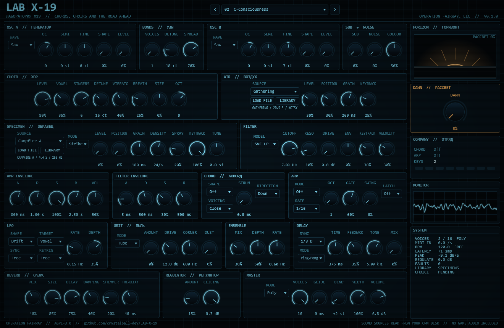

# LAB X-19

A chord and pad synthesizer for Windows, built as a VST® 3 instrument and a standalone app. It is the third LAB X- plugin from OPERATION FAIRWAY, after [LAB X-3](https://github.com/crystalball-dev/lab-x-3) and [LAB X-10](https://github.com/crystalball-dev/lab-x-10).

Laboratory X-19 lies inside the Chornobyl power plant in *S.T.A.L.K.E.R.*. It is where C-Consciousness, many minds fused into one, waits beside the Wish Granter, and where Strelok chooses whether to join them or end them. LAB X-19 is about the other kind of choir: people living on the brink who choose each other. Its sounds lean toward hope. The future is uncertain, and the possibilities are endless.

LAB X-19 is a fan project. It is not affiliated with or endorsed by GSC Game World, and this repository contains no game audio.



## What it does

Ethereal pads, choir pads, arpeggios, stabs, plucks, heavy saws, and clean chords with a gritty undertone.

- **OSC A and BONDS.** Saw that morphs into a square, pulse, triangle, folded sine, or a wavetable cut from the SPECIMEN source, through up to seven detuned copies spread across the stereo field.
- **OSC B, SUB and NOISE.** A second oscillator for octaves, fifths and detuned layers, a sine sub and coloured noise.
- **CHOIR.** A synthesized group of up to eight singers per note. Each has its own detune, drift and vibrato that fades in after the attack. Formant filters glide through the vowels U, O, A, E and I, and SIZE moves them from a small voice to a large one. BREATH adds air.
- **SPECIMEN.** Plays sounds from your own STALKER SPECIMENS library: campfire guitar chords from *S.T.A.L.K.E.R. 2* in twelve keys, a harmonica, an old piano, the bells of Zalissya, wind chimes and the games' own score. STRIKE plays a sound once like a sampler key, transposed from its recorded pitch, so every key strums the campfire guitar. GRAIN turns it into a granular cloud.
- **AIR.** A second granular layer for texture under everything, by default a crowd murmuring.
- **CHORD and STRUM.** One key plays a whole chord: major, minor, sus, add9, sevenths, ninths, 6/9, minor eleventh, fifths, octaves or lydian, in close, open, wide or drop-2 voicing. STRUM spreads the notes up to 250 ms apart, down, up, alternating or random.
- **ARP.** Locks to FL Studio's tempo: up, down, up-down, random, in played order, or whole chords on every step. 1/4 to 1/32 with triplets and dotted rates, one to four octaves, gate, swing and latch.
- **FILTER.** Transistor ladder and a state-variable filter (low-, band-, high-pass) with envelope, key and velocity tracking.
- **GRIT.** The gritty undertone. Only the band above CORNER is driven (tube, tape, radio or crush), and the result is added under the clean signal, so the low end of a chord stays exactly as it was. DUST adds crackle and hiss that follow the music and stop when it stops.
- **ENSEMBLE, DELAY, REVERB.** A three-tap string-machine chorus, tempo-synced stereo or ping-pong echoes, and an eight-line reverb whose SHIMMER pitches the tail up an octave as it fades.
- **REGULATOR.** Compressor and a look-ahead limiter at the output ceiling.
- **DAWN.** One knob that clears the haze: it opens the filter, brightens the choir's vowel, adds shimmer, air and ensemble, and pulls the grit back. The mod wheel adds to it.
- **19 factory presets**, named after the lore, matched in loudness.
- **Runaway guard.** Every voice and every effect stage is checked every 16 samples. Anything that blows up is silenced
  and reset instead of reaching your speakers, counted under FAULTS in SYSTEM, and written to
  `%APPDATA%\OPERATION FAIRWAY, LLC\LAB X-19 faults.log` with the settings at the time.

## Playing it in FL Studio

- **Chords:** with a CHORD shape chosen, play single notes. Each key becomes its chord. Set STRUM for a guitar-like spread.
- **Arps:** the arp follows FL's tempo and locks to the bar while the song plays. A note that starts between steps waits for the next step. When FL is stopped, the arp runs at the last tempo FL reported. LATCH keeps a phrase going after you let go. A new key replaces it.
- **Campfire guitar:** choose a Campfire source with SPECIMEN in STRIKE mode (or load the *Campfire at Rostok* preset). The chord's root key, in octave 3, plays the recording at its own pitch. Other keys transpose it.
- **Legato:** in Legato mode, overlap two notes and the second slides from the first. With ARP at full gate, the arp slides from step to step.
- **Note names:** FL Studio calls MIDI note 60 "C5". The SPECIMEN root notes are MIDI 48 to 59, shown in FL as C4 to B4.

## Sound sources

SPECIMEN and AIR read audio from a STALKER SPECIMENS folder of sounds extracted from your own copies of the games, laid out as `<drive>:\_AUDIO\STALKER SPECIMENS\<game>\sounds\...`. The plugin finds that folder on drives C: to H:. Otherwise, use LIBRARY to point at it. LOAD FILE takes any WAV, OGG, FLAC or AIFF. The repository holds only relative paths.

## Building on Windows

You need Visual Studio 2022 Build Tools with the C++ workload, CMake 3.22 or newer, and a checkout of JUCE 9.

```
cmake -S . -B build -G "Visual Studio 17 2022" -A x64 -DLABX19_JUCE_PATH=C:/path/to/JUCE
cmake --build build --config Release --target LabX19_VST3 LabX19_Standalone LabX19Render
```

`scripts/build.ps1` runs both steps.

## Installing in FL Studio

Copy the plugin file into the standard VST3 folder. `scripts/install.ps1` does this and refuses if FL Studio has the plugin loaded:

```
build/LabX19_artefacts/Release/VST3/LAB X-19.vst3/Contents/x86_64-win/LAB X-19.vst3
  -> C:\Program Files\Common Files\VST3\LAB X-19.vst3
```

Then scan for plugins in FL Studio. LAB X-19 appears under Generators.

## Testing

- `LabX19Render` renders presets offline to WAV with a simulated host tempo and reports level, largest sample jump, non-finite samples, latency and render speed.
- `python Tests/run_tests.py` runs the battery: pitch at three sample rates, every chord shape and voicing, strum timing, arp timing on the grid with swing, unison spread, choir vowels and level, filter slopes, grit leaving the low band untouched, shimmer decay, delay timing, Strike transposition, every specimen source in both modes, every preset, preset switching, state round trip, legato and sustain, a 300-second randomised session, CPU load and pluginval.
- `scripts/validate.ps1` runs [pluginval](https://github.com/Tracktion/pluginval).

## Licence

LAB X-19 is free software under the GNU Affero General Public License v3.0; see `LICENSE`. It is built with [JUCE](https://juce.com) under the AGPLv3 and the Steinberg VST 3 SDK under the MIT licence.

VST is a registered trademark of Steinberg Media Technologies GmbH.
